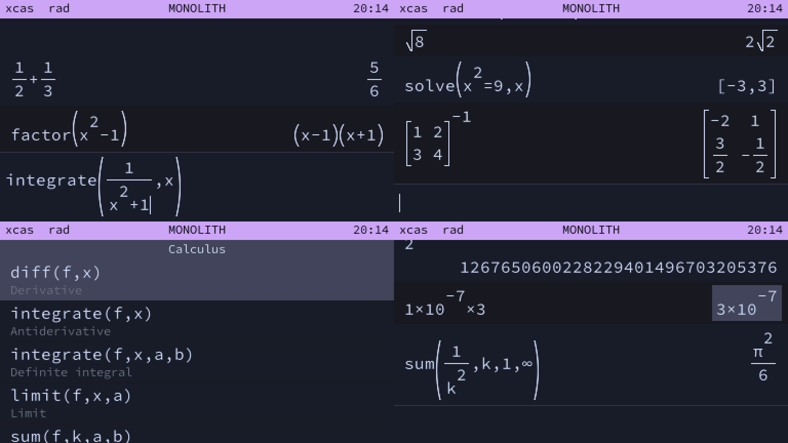

# Monolith

Monolith is [KhiCAS](https://www-fourier.univ-grenoble-alpes.fr/~parisse/casio/) (Bernard Parisse's
Giac/Xcas computer algebra system for the Casio fx-CG50) with a new front end. You type maths in
2D and get pretty-printed answers, in a screen modelled on the
[Upsilon](https://github.com/UpsilonNumworks/Upsilon) Calculation app and coloured with
[Catppuccin Mocha](https://catppuccin.com). The full Giac engine underneath is unchanged.



## Features

| | |
|---|---|
| 2D input | Fractions, powers, roots, n-th roots, \|x\|, e^x and ×10^x are boxes you type into. The arrows move in and out of them, as in Upsilon |
| Pretty history | Each calculation is a cell: input on the left, exact result on the right, on alternating bands. Fractions, roots, matrices and powers of ten are drawn properly |
| Reuse | ↑ selects past results and inputs, EXE puts them back in the input, DEL deletes one |
| Toolbox | OPTN opens an Upsilon-style toolbox built from KhiCAS's menus, with short descriptions. It also holds the catalogue, variables, file menu, settings and the Python/Xcas switch. The F-key bar is gone |
| Mocha everywhere | KhiCAS's own screens (graphs, catalogue, file menu, editor) are recoloured to match |
| Side by side | The files are `monolith.g3a` and `monolith.ac2`, so stock KhiCAS can stay installed |

## Install

1. Download `monolith-<version>.zip` from the [releases](../../releases) and unzip it.
2. Connect the calculator by USB and choose USB Flash on it.
3. Copy `monolith.g3a` and `monolith.ac2` to the root of its storage.
4. Eject it in Windows before unplugging, then open **Monolith** from the main menu.

Both files must come from the same release. Monolith needs about 4.4 MB of storage. It shares
`session.xw` (your history and variables) with stock KhiCAS.

## Keys

| Key | Action |
|---|---|
| fraction key, ÷ | Fraction (the term on the left becomes the numerator) |
| ^, x², √, SHIFT x^□ | Power, square, square root, n-th root |
| ← → ↑ ↓ | Move through the expression. ↑ at the top selects the history |
| EXE | Evaluate, or reuse the selected history entry |
| DEL / AC | Delete / clear the input |
| OPTN | Toolbox |
| F1 F2 F3 | Toolbox at Algebra, Calculus, Graphs |
| F4 | Catalogue |
| F5 | A⇄a |
| F6 | KhiCAS file menu (sessions, scripts, clear history) |

## Build

Linux or WSL (Ubuntu), with `build-essential cmake libpng-dev curl python3`. The first build
downloads KhiCAS's sources and Parisse's prebuilt `sh3eb-elf` toolchain (about 330 MB) from
`www-fourier.univ-grenoble-alpes.fr`, and asks for `sudo` once to put the toolchain in
`/home/parisse`, where KhiCAS's Makefile expects it.

```sh
tools/build.sh            # fetch (first run), apply the patches, build
tools/build.sh --clean    # start again from a fresh KhiCAS tree
```

From Windows: `.\build.ps1` (add `-Clean`, or `-Distro <name>` if your distribution is not `Ubuntu`).

The build writes `build/monolith.g3a`, `build/monolith.ac2` and `build/release/monolith-<version>.zip`.
The version comes from [`VERSION`](VERSION). The KhiCAS tree lives in `~/monolith-work`
(set `MONOLITH_WORK` to move it). Only Monolith's files recompile, so rebuilds take seconds.

### Developing the screen on a PC

The Calculation screen (`src/zupsui.cpp`) has no calculator dependencies. `make -C host test`
builds it natively and runs the key scripts in `host/scripts/`: editor checks plus screenshots in
`host/out/`, with answers faked from a table. Use it to try layout changes before going to the
calculator.

## Repository layout

| Path | Contents |
|---|---|
| `src/zupsui.cpp`, `upsui.h` | The Calculation screen: layout tree, 2D editor, renderer, giac text ⇄ layout, toolbox |
| `src/zupsmain.cc` | Glue to KhiCAS: keys, evaluation through `run()`, history kept in KhiCAS's console |
| `src/mocha.c`, `mocha_tables.h` | Recolours KhiCAS's own screens (linked with `--wrap`) |
| `src/ups_fonts.h` | Glyphs of Upsilon's fonts (Source Code Pro), generated by `tools/dumpfont.cpp` |
| `patches/` | Small, idempotent edits to the pristine KhiCAS sources, applied in order |
| `assets/` | Menu icons, drawn by `tools/make_icons.py` |
| `tools/` | `build.sh`, and the generators for the colour tables, fonts and icons |
| `host/` | PC harness and test scripts |

Files named `z*` go to the RAM part (`monolith.ac2`) through KhiCAS's linker script, because the
`.g3a` is almost full.

## Licence

GPL-3.0-or-later, see [`LICENSE`](LICENSE).

## Credits

- KhiCAS and Giac: Bernard Parisse et al., GPL
- MicroPython: Damien George et al., MIT
- Catppuccin palette: the Catppuccin organisation, MIT
- Glyphs: Source Code Pro by Adobe, SIL Open Font License 1.1, as rasterised for Upsilon
- Look and spacing modelled on Upsilon/NumWorks Epsilon (no code taken from them)
